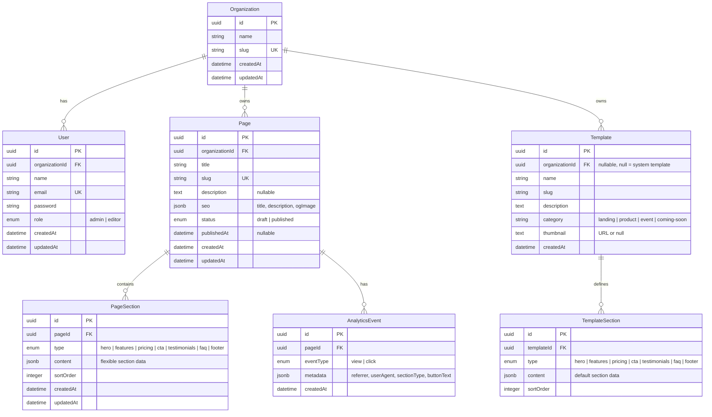

# Database Schema — Hermes Landing Studio

## Entity Relationship Diagram



## TypeORM Entity Definitions

### Organization

```typescript
import { Entity, PrimaryGeneratedColumn, Column, OneToMany, CreateDateColumn } from 'typeorm';
import { User } from './user.entity';
import { Page } from './page.entity';

@Entity('organizations')
export class Organization {
  @PrimaryGeneratedColumn('uuid')
  id: string;

  @Column({ type: 'text' })
  name: string;

  @Column({ type: 'text', unique: true })
  slug: string;

  @CreateDateColumn()
  createdAt: Date;

  @UpdateDateColumn()
  updatedAt: Date;

  @OneToMany(() => User, user => user.organization)
  users: User[];

  @OneToMany(() => Page, page => page.organization)
  pages: Page[];
}
```

### User

```typescript
import { Entity, PrimaryGeneratedColumn, Column, ManyToOne, JoinColumn, CreateDateColumn } from 'typeorm';
import { Organization } from './organization.entity';

export enum UserRole {
  ADMIN = 'admin',
  EDITOR = 'editor',
}

@Entity('users')
export class User {
  @PrimaryGeneratedColumn('uuid')
  id: string;

  @Column({ type: 'text' })
  name: string;

  @Column({ type: 'text', unique: true })
  email: string;

  @Column({ type: 'text', select: false })
  password: string;

  @Column({ type: 'text', default: UserRole.ADMIN })
  role: UserRole;

  @Column({ type: 'text' })
  organizationId: string;

  @ManyToOne(() => Organization, org => org.users, { onDelete: 'CASCADE' })
  @JoinColumn({ name: 'organizationId' })
  organization: Organization;

  @CreateDateColumn()
  createdAt: Date;

  @UpdateDateColumn()
  updatedAt: Date;
}
```

### Page

```typescript
import { Entity, PrimaryGeneratedColumn, Column, ManyToOne, JoinColumn, OneToMany, CreateDateColumn, UpdateDateColumn } from 'typeorm';
import { Organization } from './organization.entity';
import { PageSection } from './page-section.entity';
import { AnalyticsEvent } from './analytics-event.entity';

export enum PageStatus {
  DRAFT = 'draft',
  PUBLISHED = 'published',
}

@Entity('pages')
export class Page {
  @PrimaryGeneratedColumn('uuid')
  id: string;

  @Column({ type: 'text' })
  title: string;

  @Column({ type: 'text', unique: true })
  slug: string;

  @Column({ type: 'text', nullable: true })
  description: string;

  @Column({ type: 'jsonb', nullable: true, default: { title: null, description: null, ogImage: null } })
  seo: { title: string | null; description: string | null; ogImage: string | null };

  @Column({ type: 'text', default: PageStatus.DRAFT })
  status: PageStatus;

  @Column({ type: 'text', nullable: true })
  publishedAt: string;

  @Column({ type: 'text' })
  organizationId: string;

  @ManyToOne(() => Organization, org => org.pages, { onDelete: 'CASCADE' })
  @JoinColumn({ name: 'organizationId' })
  organization: Organization;

  @OneToMany(() => PageSection, section => section.page, { cascade: true })
  sections: PageSection[];

  @OneToMany(() => AnalyticsEvent, event => event.page)
  analyticsEvents: AnalyticsEvent[];

  @CreateDateColumn()
  createdAt: Date;

  @UpdateDateColumn()
  updatedAt: Date;
}
```

### PageSection

```typescript
import { Entity, PrimaryGeneratedColumn, Column, ManyToOne, JoinColumn, CreateDateColumn, UpdateDateColumn } from 'typeorm';
import { Page } from './page.entity';

export enum SectionType {
  HERO = 'hero',
  FEATURES = 'features',
  PRICING = 'pricing',
  CTA = 'cta',
  TESTIMONIALS = 'testimonials',
  FAQ = 'faq',
  FOOTER = 'footer',
}

@Entity('page_sections')
export class PageSection {
  @PrimaryGeneratedColumn('uuid')
  id: string;

  @Column({ type: 'text' })
  type: SectionType;

  @Column({ type: 'jsonb', default: {} })
  content: Record<string, any>;

  @Column({ type: 'integer', default: 0 })
  sortOrder: number;

  @Column({ type: 'text' })
  pageId: string;

  @ManyToOne(() => Page, page => page.sections, { onDelete: 'CASCADE' })
  @JoinColumn({ name: 'pageId' })
  page: Page;

  @CreateDateColumn()
  createdAt: Date;

  @UpdateDateColumn()
  updatedAt: Date;
}
```

### Template

```typescript
import { Entity, PrimaryGeneratedColumn, Column, OneToMany, CreateDateColumn } from 'typeorm';
import { TemplateSection } from './template-section.entity';

@Entity('templates')
export class Template {
  @PrimaryGeneratedColumn('uuid')
  id: string;

  @Column({ type: 'text' })
  name: string;

  @Column({ type: 'text', unique: true })
  slug: string;

  @Column({ type: 'text', nullable: true })
  description: string;

  @Column({ type: 'text', default: 'landing' })
  category: string;

  @Column({ type: 'text', nullable: true })
  thumbnail: string;

  @Column({ type: 'text', nullable: true })
  organizationId: string;  // null = system template

  @OneToMany(() => TemplateSection, ts => ts.template, { cascade: true })
  sections: TemplateSection[];

  @CreateDateColumn()
  createdAt: Date;
}

@Entity('template_sections')
export class TemplateSection {
  @PrimaryGeneratedColumn('uuid')
  id: string;

  @Column({ type: 'text' })
  type: SectionType;

  @Column({ type: 'jsonb', default: {} })
  content: Record<string, any>;

  @Column({ type: 'integer', default: 0 })
  sortOrder: number;

  @Column({ type: 'text' })
  templateId: string;

  @ManyToOne(() => Template, template => template.sections, { onDelete: 'CASCADE' })
  @JoinColumn({ name: 'templateId' })
  template: Template;
}
```

### AnalyticsEvent

```typescript
import { Entity, PrimaryGeneratedColumn, Column, ManyToOne, JoinColumn, CreateDateColumn } from 'typeorm';
import { Page } from './page.entity';

export enum EventType {
  VIEW = 'view',
  CLICK = 'click',
}

@Entity('analytics_events')
export class AnalyticsEvent {
  @PrimaryGeneratedColumn('uuid')
  id: string;

  @Column({ type: 'text' })
  eventType: EventType;

  @Column({ type: 'jsonb', nullable: true, default: {} })
  metadata: Record<string, any>;

  @Column({ type: 'text' })
  pageId: string;

  @ManyToOne(() => Page, page => page.analyticsEvents, { onDelete: 'CASCADE' })
  @JoinColumn({ name: 'pageId' })
  page: Page;

  @CreateDateColumn()
  createdAt: Date;
}
```

---

## Key SQL Queries

### Dashboard KPIs

```sql
-- Page count summary per organization
SELECT
  COUNT(*) AS total_pages,
  COUNT(CASE WHEN status = 'published' THEN 1 END) AS published_pages,
  COUNT(CASE WHEN status = 'draft' THEN 1 END) AS draft_pages
FROM pages
WHERE organizationId = ?;

-- Total views this month (from analytics_events)
SELECT COUNT(*) AS total_views
FROM analytics_events ae
WHERE ae.pageId IN (SELECT id FROM pages WHERE organizationId = ?)
  AND ae.eventType = 'view'
  AND ae.createdAt >= date('now', 'start of month');
```

### Daily Analytics Chart

```sql
-- Views per day for last N days
SELECT
  date(ae.createdAt) AS day,
  COUNT(CASE WHEN ae.eventType = 'view' THEN 1 END) AS views,
  COUNT(CASE WHEN ae.eventType = 'click' THEN 1 END) AS clicks
FROM analytics_events ae
WHERE ae.pageId = ?
  AND ae.createdAt >= date('now', ? || ' days')
GROUP BY date(ae.createdAt)
ORDER BY day ASC;
```

### Page List with Search + Filter

```sql
-- Multi-tenant pages with search and status filter
SELECT id, title, slug, status, published_at, created_at,
  (SELECT COUNT(*) FROM analytics_events WHERE pageId = p.id AND eventType = 'view') AS view_count
FROM pages p
WHERE p.organizationId = ?
  AND (p.status = ? OR ? = 'all')
  AND (p.title LIKE ? OR p.slug LIKE ?)
ORDER BY p.updatedAt DESC;
```

### Section Content by Type

```sql
-- All sections for a page, ordered by sortOrder
SELECT id, type, content, sort_order
FROM page_sections
WHERE pageId = ?
ORDER BY sortOrder ASC;
```

---

## Neon/PostgreSQL Compatibility Notes

| Feature | SQLite | PostgreSQL | Migration |
|---------|--------|------------|-----------|
| Date functions | `date('now', '-7 days')` | `CURRENT_DATE - INTERVAL '7 days'` | Env-aware query builder |
| Aggregation | `COUNT(*)` works | Same | No change |
| JSON column | `jsonb` type (needs text) | `jsonb` | SQLite: use text + JSON.parse; PostgreSQL: native jsonb |
| UUID generation | `uuid_generate_v4()` or app-level | `gen_random_uuid()` | App-level UUID (TypeORM handles this) |
| Full-text search | FTS5 (requires virtual table) | `tsvector` / `tsquery` | Different approaches — skip for MVP |
| `date` extraction | `date(createdAt)` | `createdAt::date` | Query builder abstraction |
| COALESCE | `COALESCE(SUM(x), 0)` works | Same | Compatible |

### Env-Aware Query Strategy

For dev (SQLite): use raw queries with SQLite syntax, wrapped in repository methods.
For prod (PostgreSQL): override the query in a separate adapter or use TypeORM QueryBuilder which abstracts most differences.

TypeORM's QueryBuilder (`.createQueryBuilder()`) handles most SQL differences automatically. Only raw analytics queries need attention:

```typescript
// Dashboard daily stats — env-aware
async getDailyStats(pageId: string, days: number): Promise<DailyStat[]> {
  const cutoff = new Date();
  cutoff.setDate(cutoff.getDate() - days);

  if (process.env.NEON_DATABASE_URL) {
    // PostgreSQL
    return this.dataSource.query(`
      SELECT
        ae.createdAt::date AS day,
        COUNT(CASE WHEN ae.event_type = 'view' THEN 1 END) AS views,
        COUNT(CASE WHEN ae.event_type = 'click' THEN 1 END) AS clicks
      FROM analytics_events ae
      WHERE ae.pageId = ? AND ae.createdAt >= $2
      GROUP BY ae.createdAt::date
      ORDER BY day ASC
    `, [pageId, cutoff.toISOString()]);
  } else {
    // SQLite
    return this.dataSource.query(`
      SELECT
        date(ae.createdAt) AS day,
        COUNT(CASE WHEN ae.eventType = 'view' THEN 1 END) AS views,
        COUNT(CASE WHEN ae.eventType = 'click' THEN 1 END) AS clicks
      FROM analytics_events ae
      WHERE ae.pageId = ? AND ae.createdAt >= ?
      GROUP BY date(ae.createdAt)
      ORDER BY day ASC
    `, [pageId, cutoff.toISOString()]);
  }
}
```
