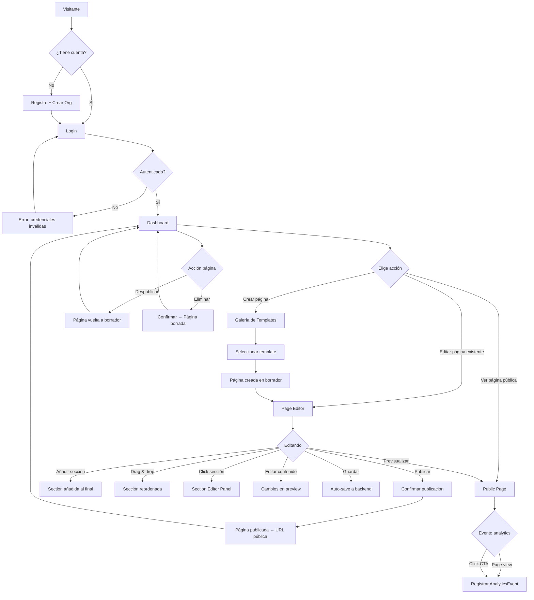
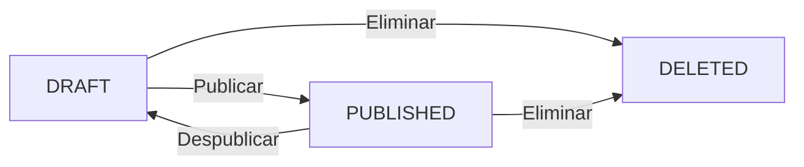

# Flow Diagrams — Hermes Landing Studio

## Main User Journey



## Authentication Flow

```
1. User navigates to /login
2. If has token → validate → redirect to /dashboard
3. If no token → show login form
4. User enters email + password
5. POST /api/auth/login → { token, user }
6. On success: store token in localStorage → redirect /dashboard
7. On 401: show "Credenciales inválidas" error
8. On 409: show "Email ya registrado" (register only)
9. Register: POST /api/auth/register → creates org + user → returns token
10. Logout: clear localStorage → redirect /login
```

## Page Creation Flow

```
1. Dashboard → Click [+ Nueva Página]
2. Galería de Templates loads (GET /api/templates)
3. User clicks a template card
4. POST /api/pages { templateId, title } → creates Page + PageSections from template
5. Page sections copied from template (not referenced — independent)
6. Page created with status "draft"
7. Redirect to /editor/:pageId
```

## Section Management Flow

```
1. Page Editor shows: sidebar (section list) + preview
2. User drags section handle (☰) → reorder (PATCH /api/pages/:id/sections/reorder)
3. User clicks [+] → POST /api/pages/:id/sections { type: "hero" } → appended
4. User clicks section → Section Editor Panel opens (right side)
5. User edits fields → changes reflected in preview via local signal
6. Auto-save: POST /api/pages/:id/sections/:sectionId (debounced 30s)
7. User clicks 🗑️ → Confirm → DELETE /api/pages/:id/sections/:sectionId
```

## Page Publishing Flow

```
1. User clicks [Publicar] from Page Editor
2. Confirm dialog: "¿Publicar esta página? Estará disponible en /{slug}"
3. User confirms → PATCH /api/pages/:id { status: "published" }
4. Backend sets status="published", publishedAt=new Date()
5. Page becomes accessible at GET /{slug} (public, no auth)
6. SEO meta tags rendered in <head>
7. Button changes to [Despublicar] in dashboard
```

## Analytics Flow

```
1. Public page loaded → Angular component fires onInit
2. POST /api/analytics { pageId, eventType: "view", metadata: { referrer, userAgent } }
3. No auth required — anonymous endpoint
4. CTA clicks → POST /api/analytics { pageId, eventType: "click", metadata: { sectionType, buttonText } }
5. Dashboard shows aggregated data:
   - GET /api/analytics/page/:pageId/summary → total views, clicks, unique days
   - GET /api/analytics/page/:pageId/daily?days=7 → per-day view count
6. Backend aggregates: SELECT date, COUNT(*) FROM analytics_events WHERE pageId=? GROUP BY date
```

## Status Machine (Page)



Valid transitions:
- draft → published
- published → draft
- draft → deleted
- published → deleted
